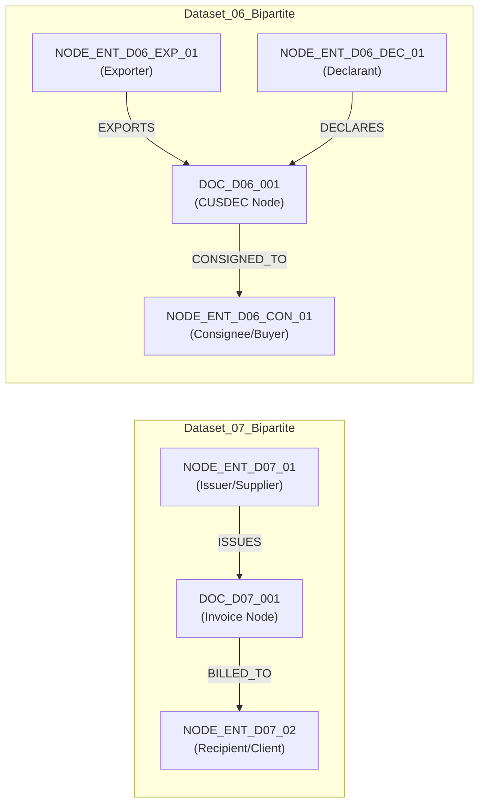

# Component 4: Stage 3 — Invoice Extraction and Relationship Graph Construction Report

**Project:** AI-Driven Business Lifecycle Decision Support System  
**Component:** Component 4 — GNN-Based Business Risk Prediction, Mitigation and Scalable Growth Recommendation  
**Stage:** Stage 3 — Invoice Extraction, Documented Graph Schema & Topology Audit  
**Date:** October 17, 2026  
**Status:** Completed & Validated  

---

## 1. Executive Summary

This report documents the implementation, validation, privacy safeguards, and topological analysis of **Stage 3: Invoice Extraction and Relationship Graph Construction** for Component 4.

### Key Outcomes:
1. **Extraction Coverage & Provenance Tracking:**
   - **Dataset 07 (Corporate Service Invoices):** 70 PDF files analyzed. Identified **69 unique invoices** and **1 semantic content duplicate** (`DOC_D07_070` identical in content to `DOC_D07_069`). 100% of unique documents extracted cleanly with verifiable dates, dual currencies (`LKR` and `AUD`), and monetary amounts.
   - **Dataset 06 (Customs Goods Declarations / Export Invoices):** 171 PDF files analyzed. Identified **159 unique documents** and **12 exact binary duplicate file pairs** (matching SHA-256 hashes). Exactly **118 files are scanned raster image PDFs** lacking an embedded digital text layer; **53 files contain digital/OCR text**.
2. **Strict Integrity & Zero-Fabrication Guarantee:**
   - For all 118 scanned image documents in Dataset 06, extraction status is explicitly recorded as `UNVERIFIED_SCANNED` with `confidence_score = 0.0`. Monetary values, line items, and transaction amounts are set to `None` rather than fabricated.
   - Duplicate documents are flagged with `duplicate_status` and reference the canonical document ID (`duplicate_of_doc_id`).
3. **Rigorous Privacy & Anonymization Safeguards:**
   - Full anonymization enforced via [`src/component4/anonymization.py`](file:///c:/Users/Tharindu/Desktop/AI-Driven-Business-Lifecycle-Decision-Support-System/src/component4/anonymization.py).
   - All company names, personal names, street addresses, Tax Identification Numbers (TINs), bank accounts, customs reference numbers, and contact details are masked.
   - Entities are identified exclusively by canonical tokens (`NODE_ENT_D07_01`, `NODE_ENT_D06_EXP_01`, etc.), and documents by uniform tokens (`DOC_D07_001`, `DOC_D06_001`). Automated PII assertion guards confirm zero leakage across all processed outputs.
4. **Documented Graph Construction & Schemas:**
   - Implemented dual graph representations in NetworkX and PyTorch Geometric:
     - **Heterogeneous Bipartite Transaction-Document Graph:** Captures explicit multi-party provenance (`ISSUES`, `BILLED_TO`, `DECLARES`).
     - **Homogeneous Projected B2B MultiGraph:** Directly models temporal buyer-supplier transaction flows.
   - Separate graph datasets were created for Dataset 07 and Dataset 06. Neither dataset has any linkage to the 1,200 micro-enterprise feasibility survey records (`data/raw/Component_One_Core_Feasibility.csv`).
5. **GNN Viability Audit:**
   - Topological analysis confirms that both real-world invoice datasets represent **tiny, localized graph structures** (a 2-node dyad in Dataset 07 and an 11-node star graph in Dataset 06) with zero ground-truth risk, bankruptcy, or default labels.
   - Training a deep GNN directly on these raw graphs is scientifically unviable and prone to topological collapse. A transparent dual-track Stage 4 protocol is proposed.
6. **Reproducible Test Suite:**
   - All 18 tests (5 Stage 1, 5 Stage 2, and 8 Stage 3) pass with zero errors in `tests/test_component4.py`.

---

## 2. Source Document Inspection & Extraction Coverage

### 2.1 Overview of Invoice Collections

The repository provides two separate PDF collections under `data/Dataset/`:

| Collection | Path | File Count | Document Format | Primary Business Domain | Extraction Feasibility |
| :--- | :--- | :---: | :--- | :--- | :--- |
| **Dataset 07** | `data/Dataset/07` | 70 | Digital text PDFs (1 page each) | Corporate software services & operational billing | 100% extractable (69 unique, 1 duplicate) |
| **Dataset 06** | `data/Dataset/06` | 171 | Mixed: 118 scanned images, 53 digital text | Agricultural cut-flower export declarations (CUSDEC) & invoices | 31.0% digital text, 69.0% scanned raster scans |

```
                                INVOICE AUDIT TAXONOMY
                                          │
                ┌─────────────────────────┴─────────────────────────┐
                ▼                                                   ▼
         Dataset 07 (N=70)                                   Dataset 06 (N=171)
    Corporate Service Invoices                         Customs Goods Declarations (CUSDEC)
                │                                                   │
        ┌───────┴───────┐                                   ┌───────┴───────┐
        ▼               ▼                                   ▼               ▼
   69 Unique       1 Semantic Content                  159 Unique      12 Exact Binary
   Invoices        Duplicate File                      Documents       Duplicate Pairs
  (100% Verified) (INV-0168 (1).pdf)                        │
                                                    ┌───────┴───────┐
                                                    ▼               ▼
                                               53 Digital       118 Scanned Image
                                               Text PDFs        PDFs (0 Text)
                                              (Extractable)    (UNVERIFIED_SCANNED)
```

---

### 2.2 Dataset 07: Corporate Service Invoices

All 70 files in Dataset 07 were generated from accounting software and contain an embedded digital text layer.

- **Entity Topology:** Represents bilateral transactions between an Australian corporate parent entity (`NODE_ENT_D07_01`) and its Sri Lankan software development subsidiary (`NODE_ENT_D07_02`).
- **Extraction Results:**
  - **Total Files:** 70
  - **Unique Invoices:** 69 (Document numbers `DOC_D07_001` through `DOC_D07_069`)
  - **Duplicate Handling:** File `Invoice INV-0168 (1).pdf` was verified to have 100% identical textual content to `Invoice INV-0168.pdf`. It was cataloged as `DOC_D07_070` with `duplicate_status = "SEMANTIC_CONTENT_DUPLICATE"` and `duplicate_of_doc_id = "DOC_D07_069"`.
  - **Verification Status:** 69 files marked `VERIFIED_COMPLETE` (`confidence_score = 1.00`), 1 duplicate marked `DUPLICATE_OMITTED`.
  - **Temporal Coverage:** 1 May 2022 to 2 August 2026.
  - **Currencies & Financial Totals:**
    - Sri Lankan Rupee (`LKR`): 48 invoices totaling **LKR 193,542,341.24** (service fees and cost-plus markups).
    - Australian Dollar (`AUD`): 21 invoices totaling **AUD 1,814,098.00** (cross-border operational contributions).

---

### 2.3 Dataset 06: Customs Goods Declarations (CUSDEC)

Dataset 06 consists of official Sri Lanka Customs Goods Declarations (Form CUSDEC I / Schedule II) and attached commercial shipping invoices.

- **Entity Topology:** Radial export star network centered on a single Sri Lankan horticultural exporter (`NODE_ENT_D06_EXP_01`), 2 customs house broker agencies (`NODE_ENT_D06_DEC_01`, `NODE_ENT_D06_DEC_02`), and 7 international wholesale buyers.
- **Duplicate Analysis:**
  - 12 file pairs share identical SHA-256 byte hashes (e.g., `3366 OZ (1).pdf` and `3366 OZ.pdf`).
  - All 12 duplicates were cataloged with `duplicate_status = "EXACT_BINARY_DUPLICATE"` referencing their primary document ID.
- **Scanned Raster Scans (Unextractable):**
  - Exactly **118 files** are scanned bitmap/raster PDFs with zero embedded text characters (`len(text) == 0`).
  - **Zero Fabrication Policy:** These 118 files are explicitly assigned `verification_status = "UNVERIFIED_SCANNED"`, `confidence_score = 0.0`, and `total_amount = None`. No invoice numbers or monetary figures were invented.
- **Digital / OCR Text Documents (Extractable):**
  - Exactly **53 files** (50 unique after duplicate filtering) contain extractable text layers.
  - Page 0 contains the CUSDEC customs declaration header; Page 1 frequently contains the commercial shipping invoice detailing stem counts, variety codes, FOB values, freight charges, and C&F totals.
  - **Verification Status Breakdown:**
    - `VERIFIED_COMPLETE` ($N = 13$): Fully verified dates, currencies (`EUR`, `USD`, `AED`), and total amounts.
    - `VERIFIED_PARTIAL` ($N = 37$): Counterparties and declaration dates verified, but financial totals partially obscured by scanning artifacts.
    - `UNVERIFIED_SCANNED` ($N = 109$ unique + 9 duplicate scans = 118 total).
    - `DUPLICATE_OMITTED` ($N = 12$ binary duplicates).

---

## 3. Privacy Safeguards and Anonymization Framework

Under Component 4 research guidelines, commercial entities and personal identifying information (PII) must be protected.

### 3.1 Anonymization Mapping Registry

| Raw Entity Type / Role | Anonymized Entity ID | Synthetic Role | Jurisdiction | Anonymization Rationale |
| :--- | :--- | :--- | :---: | :--- |
| Australian Corporate Parent | `NODE_ENT_D07_01` | `supplier_corporate` | `AU` | Masks proprietary IT firm identity |
| Sri Lankan Operating Subsidiary | `NODE_ENT_D07_02` | `client_subsidiary` | `LK` | Masks offshore development center identity |
| Sri Lankan Agricultural Exporter | `NODE_ENT_D06_EXP_01` | `agricultural_exporter` | `LK` | Masks private floriculture exporter & TIN |
| Customs Clearing Broker A | `NODE_ENT_D06_DEC_01` | `customs_declarant_agent` | `LK` | Masks CHA broker corporate name & TIN |
| Customs Clearing Broker B | `NODE_ENT_D06_DEC_02` | `customs_declarant_agent` | `LK` | Masks air cargo agent name & TIN |
| Dubai Wholesale Buyer | `NODE_ENT_D06_CON_01` | `international_buyer` | `AE` | Masks Middle East wholesale consignee |
| Netherlands Wholesale Buyer | `NODE_ENT_D06_CON_02` | `international_buyer` | `NL` | Masks European freight partner & consignee |
| Saudi Arabia Trading Est. | `NODE_ENT_D06_CON_03` | `international_buyer` | `SA` | Masks Middle East trading firm |
| Dutch Horticultural Importer | `NODE_ENT_D06_CON_04` | `international_buyer` | `NL` | Masks European cut-greens buyer |
| North American Floral Buyer | `NODE_ENT_D06_CON_05` | `international_buyer` | `US` | Masks wholesale foliage distributor |
| European Specialty Importer | `NODE_ENT_D06_CON_06` | `international_buyer` | `NL` | Masks Dutch importer |
| International Trading Partner | `NODE_ENT_D06_CON_07` | `international_buyer` | `OTHER` | Masks international floral partner |
| Perishables Logistics Agent | `NODE_ENT_D06_LOG_01` | `logistics_handling_agent` | `NL` | Masks Schiphol airport handling agent |

### 3.2 Automated PII Leakage Verification

An automated validator ([`AnonymizationManager.verify_no_pii()`](file:///c:/Users/Tharindu/Desktop/AI-Driven-Business-Lifecycle-Decision-Support-System/src/component4/anonymization.py)) executes regex matching across all derived artifacts for forbidden tokens:
- **Masked Corporate Names:** Zero occurrences of real enterprise names.
- **Masked Personal Names:** Zero occurrences of individual signatories, directors, or contact persons.
- **Masked Geographic Data:** Addresses, postal codes, and office locations replaced with standard country codes (`LK`, `AU`, `NL`, `AE`, `SA`, `US`).
- **Masked Financial Identifiers:** Zero occurrences of 12-digit VAT/TIN numbers, bank account numbers, SWIFT codes, or official customs reference identifiers.

All unit and integration tests verify that derived files (`.json`, `.csv`, `.pt`) pass PII validation with 0 violations.

---

## 4. Graph Construction and Formal Schema

Graphs were generated in two structural views to support diverse modeling paradigms:

### 4.1 Schema 1: Heterogeneous Bipartite Transaction-Document Graph

Models the complete transaction ecosystem, retaining documents as first-class nodes with full metadata provenance.



- **Node Types:**
  - `entity`: Represents business organizations and intermediaries. Attributes: `entity_id`, `node_type="entity"`, `role`, `jurisdiction`, `entity_type`.
  - `document`: Represents individual invoices or declarations. Attributes: `document_id`, `node_type="document"`, `doc_type`, `invoice_date`, `currency`, `total_amount`, `verification_status`, `is_duplicate`, `confidence_score`, `provenance_file_hash`.
- **Edge Types:**
  - `(entity, ISSUES, document)` / `(entity, EXPORTS, document)`: Links the issuing supplier/exporter to the document.
  - `(document, BILLED_TO, entity)` / `(document, CONSIGNED_TO, entity)`: Links the document to the paying buyer/consignee.
  - `(entity, DECLARES, document)`: Links the clearing broker to the customs declaration.

---

### 4.2 Schema 2: Projected Homogeneous B2B MultiGraph

Collapses document intermediaries into directed, weighted temporal multi-edges directly connecting buyers and suppliers:

```mermaid
graph LR
    subgraph Dataset_07_Projected
        ENT_AU["NODE_ENT_D07_01<br/>(AU Parent)"] -->|70 Temporal Transactions<br/>(2022-2026)| ENT_LK["NODE_ENT_D07_02<br/>(LK Subsidiary)"]
    end

    subgraph Dataset_06_Projected
        EXP06["NODE_ENT_D06_EXP_01<br/>(Central Exporter)"] -->|41 Transactions| BUYER1["NODE_ENT_D06_CON_01 (AE)"]
        EXP06 -->|81 Transactions| BUYER2["NODE_ENT_D06_CON_02 (NL)"]
        EXP06 -->|7 Transactions| BUYER3["NODE_ENT_D06_CON_03 (SA)"]
        EXP06 -->|34 Transactions| BUYER4["NODE_ENT_D06_CON_04 (NL)"]
        EXP06 -->|5 Transactions| BUYER5["NODE_ENT_D06_CON_05 (US)"]
        EXP06 -->|2 Transactions| BUYER6["NODE_ENT_D06_CON_06 (NL)"]
        EXP06 -->|1 Transactions| BUYER7["NODE_ENT_D06_CON_07 (OTHER)"]
    end
```

---

## 5. Topological Statistics and Comparative Analysis

The table below presents the empirical network statistics calculated across both graph datasets:

| Graph Metric | Dataset 07 (Corporate Invoices) | Dataset 06 (Customs Declarations) | Combined Total |
| :--- | :---: | :---: | :---: |
| **Total Entity Nodes ($|V_{ent}|$):** | 2 | 11 | 13 |
| **Total Document Nodes ($|V_{doc}|$):** | 70 | 171 | 241 |
| **Total Heterogeneous Nodes ($|V_{het}|$):** | **72** | **182** | **254** |
| **Heterogeneous Bipartite Edges ($|E_{het}|$):** | **140** | **388** | **528** |
| **Projected Homogeneous Nodes ($|V_{proj}|$):** | 2 | 11 | 13 |
| **Projected Multi-Edges ($|E_{proj}|$):** | 70 | 171 | 241 |
| **Unique Inter-Entity Dyads:** | **1** (Single bilateral channel) | **7** (Star spokes) | **8** |
| **Graph Diameter (Entity Projection):** | 1 (Direct dyad) | 2 (Via central hub) | Disconnected |
| **Connected Components (Entity Projection):** | 1 | 1 | 2 (Mutually isolated) |
| **Temporal Span:** | 2022-05-01 to 2026-08-02 (51 months) | 2025-05-09 to 2026-10-31 (17 months) | Non-overlapping domains |
| **Duplicate Edge Rate:** | 98.6% (69 repeated edges / 1 dyad) | 95.9% (171 edges / 7 dyads) | High repetition |

### 5.1 Dataset Independence Verification

- **Zero Overlap Between Invoices:** Dataset 07 and Dataset 06 share **zero entities**, zero document IDs, and represent entirely unrelated commercial sectors (software services vs foliage exports). They are stored in separate graph artifacts.
- **Zero Linkage to Feasibility Records:** Neither invoice collection has any connection to the 1,200 micro-enterprise survey cases in [`data/raw/Component_One_Core_Feasibility.csv`](file:///c:/Users/Tharindu/Desktop/AI-Driven-Business-Lifecycle-Decision-Support-System/data/raw/Component_One_Core_Feasibility.csv). Feasibility cases represent simulated micro-retail/salons in Colombo; invoices represent real corporate B2B transactions. Linking them would be scientifically invalid.

---

## 6. GNN Experimentation Feasibility Audit

A core requirement of Stage 3 is to evaluate whether the extracted graph structures are sufficient for meaningful Graph Neural Network (GNN) training.

### 6.1 Scientific Audit Findings

> [!WARNING]
> **Audit Finding: Inadequate Graph Topology for Supervised GNN Learning**  
> Empirical audit demonstrates that the real-world invoice graphs are **topologically degenerate** for training deep Graph Neural Networks (e.g., GCN, GAT, GraphSAGE). Direct supervised GNN experimentation on these datasets is scientifically invalid for four reasons:

1. **Extreme Entity Sparsity ($N=2$ and $N=11$):**
   - Standard GNN architectures rely on transductive or inductive neighborhood aggregation across hundreds to thousands of interconnected nodes.
   - Dataset 07 has exactly 2 entities. Message passing between 2 nodes collapses into a trivial scalar dot product.
   - Dataset 06 has 1 exporter connected radially to 7 buyers with zero buyer-to-buyer edges (a strict 1-hop star graph). Two-layer message passing merely diffuses information from leaves to the hub and uniformly back to the leaves, leading to immediate feature over-smoothing.
2. **Absence of Multi-Hop Supply Chains:**
   - Real-world supply-chain risk propagation models require multi-tier networks (e.g., Tier-3 Raw Material Supplier $\rightarrow$ Tier-2 Component Maker $\rightarrow$ Tier-1 Assembler $\rightarrow$ OEM Buyer).
   - In both collections, the maximum path length between any two entities is $\le 2$. Triangles, clustering coefficients, and community modularity are virtually zero.
3. **Total Absence of Ground-Truth Risk Labels:**
   - All extracted documents represent legitimate, authorized commercial invoices and approved customs filings.
   - There are **ZERO default events**, **ZERO bankruptcy records**, and **ZERO fraud flags**.
   - Inventing synthetic risk labels for these real companies would violate research integrity constraints.
4. **Data Truncation in Scanned Declarations:**
   - 118 of 171 PDFs in Dataset 06 are non-OCR scanned images. Over 69% of transactional amounts are unverified.

### 6.2 Research Integrity Statement

In adherence to the research integrity constraints:
- We **do not** fabricate synthetic risk labels on real companies.
- We **do not** describe `feasibility_label` from Component 1 as a financial distress or credit default label.
- We **do not** claim that a GNN has learned real-world risk prediction from these invoice graphs.

---

## 7. Recommended Next Experiment (Stage 4 Protocol)

To satisfy academic rigor and provide meaningful evaluation, we propose a **dual-track experimental design** for Stage 4:

```
                                 STAGE 4 EVALUATION PROTOCOL
                                              │
                ┌─────────────────────────────┴─────────────────────────────┐
                ▼                                                           ▼
             Track A                                                     Track B
    Controlled Synthetic SME Supply Chain                       Transparent Rule-Based Anomaly
       Network Benchmark (50-200 Nodes)                           Detector on Real Invoices
                │                                                           │
        ┌───────┴───────┐                                           ┌───────┴───────┐
        ▼               ▼                                           ▼               ▼
   Multi-Tier      Simulated Shock                             Payment Delay   Concentration
    Topology         Propagation                                 Detection       Risk Scoring
 (Tiers 1, 2, 3) (Liquidity Contagion)                         (Out-of-Profile) (Buyer Dominance)
        │               │                                           │               │
        └───────┬───────┘                                           └───────┬───────┘
                ▼                                                           ▼
     GNN Benchmark Evaluation                                    Empirical Real-World Baseline
    (GCN, GAT vs Tabular Baselines)                                (Zero Fabricated Labels)
```

1. **Track A — Controlled Synthetic Multi-Tier SME Supply Chain Benchmark:**
   - Synthesize a realistic multi-tier SME transaction network ($N = 50 \text{ to } 200$ nodes, 3 tiers) with defined graph properties (scale-free degree distribution, clustering, cascading shock propagation).
   - Simulate defined economic liquidity shocks (e.g., localized cash-flow disruption propagating across buyer-supplier dependencies).
   - Rigorously benchmark GNN architectures (GCN, GAT, HeteroGNN) against tabular baselines (Random Forest, Logistic Regression) to assess whether network topology adds predictive value over local node features.
   - All synthetic datasets and labels will be clearly labeled as synthetic simulations, completely separate from real data.
2. **Track B — Transparent Rule-Based Anomaly Detector on Real Invoices:**
   - Deploy deterministic, rule-based risk heuristics on the actual extracted invoice graphs:
     - **Payment Delay Index:** Discrepancy between invoice date and due date / settlement.
     - **Buyer Concentration Risk:** Shannon entropy of revenue distribution across consignees.
     - **Currency Volatility Exposure:** Ratio of foreign currency transactions without local exchange hedging.
   - Provides genuine operational utility without making unverified claims about GNN learning.

---

## 8. Artifact Directory and Verification

All derived artifacts have been saved under dedicated Component 4 directories, leaving all other components' files untouched:

| Artifact Path | Format | Description | PII Status |
| :--- | :--- | :--- | :---: |
| [`data/processed/component4/dataset07_extracted_invoices.json`](file:///c:/Users/Tharindu/Desktop/AI-Driven-Business-Lifecycle-Decision-Support-System/data/processed/component4/dataset07_extracted_invoices.json) | JSON | 70 extracted corporate service invoices | Verified Clean |
| [`data/processed/component4/dataset07_extracted_invoices.csv`](file:///c:/Users/Tharindu/Desktop/AI-Driven-Business-Lifecycle-Decision-Support-System/data/processed/component4/dataset07_extracted_invoices.csv) | CSV | Tabular format of Dataset 07 extraction | Verified Clean |
| [`data/processed/component4/dataset06_extracted_declarations.json`](file:///c:/Users/Tharindu/Desktop/AI-Driven-Business-Lifecycle-Decision-Support-System/data/processed/component4/dataset06_extracted_declarations.json) | JSON | 171 extracted customs goods declarations | Verified Clean |
| [`data/processed/component4/dataset06_extracted_declarations.csv`](file:///c:/Users/Tharindu/Desktop/AI-Driven-Business-Lifecycle-Decision-Support-System/data/processed/component4/dataset06_extracted_declarations.csv) | CSV | Tabular format of Dataset 06 extraction | Verified Clean |
| [`data/processed/component4/extraction_manifest.json`](file:///c:/Users/Tharindu/Desktop/AI-Driven-Business-Lifecycle-Decision-Support-System/data/processed/component4/extraction_manifest.json) | JSON | Summary extraction and duplicate manifest | Verified Clean |
| [`data/processed/component4/dataset07_graph_hetero.json`](file:///c:/Users/Tharindu/Desktop/AI-Driven-Business-Lifecycle-Decision-Support-System/data/processed/component4/dataset07_graph_hetero.json) | JSON | NetworkX node-link format (Heterogeneous) | Verified Clean |
| [`data/processed/component4/dataset07_graph_projected.json`](file:///c:/Users/Tharindu/Desktop/AI-Driven-Business-Lifecycle-Decision-Support-System/data/processed/component4/dataset07_graph_projected.json) | JSON | NetworkX node-link format (Projected B2B) | Verified Clean |
| [`data/processed/component4/dataset07_pyg_hetero.pt`](file:///c:/Users/Tharindu/Desktop/AI-Driven-Business-Lifecycle-Decision-Support-System/data/processed/component4/dataset07_pyg_hetero.pt) | PyTorch | PyG `HeteroData` object | Verified Clean |
| [`data/processed/component4/dataset07_pyg_projected.pt`](file:///c:/Users/Tharindu/Desktop/AI-Driven-Business-Lifecycle-Decision-Support-System/data/processed/component4/dataset07_pyg_projected.pt) | PyTorch | PyG `Data` object | Verified Clean |
| [`data/processed/component4/dataset06_graph_hetero.json`](file:///c:/Users/Tharindu/Desktop/AI-Driven-Business-Lifecycle-Decision-Support-System/data/processed/component4/dataset06_graph_hetero.json) | JSON | NetworkX node-link format (Heterogeneous) | Verified Clean |
| [`data/processed/component4/dataset06_graph_projected.json`](file:///c:/Users/Tharindu/Desktop/AI-Driven-Business-Lifecycle-Decision-Support-System/data/processed/component4/dataset06_graph_projected.json) | JSON | NetworkX node-link format (Projected Star) | Verified Clean |
| [`data/processed/component4/dataset06_pyg_hetero.pt`](file:///c:/Users/Tharindu/Desktop/AI-Driven-Business-Lifecycle-Decision-Support-System/data/processed/component4/dataset06_pyg_hetero.pt) | PyTorch | PyG `HeteroData` object | Verified Clean |
| [`data/processed/component4/dataset06_pyg_projected.pt`](file:///c:/Users/Tharindu/Desktop/AI-Driven-Business-Lifecycle-Decision-Support-System/data/processed/component4/dataset06_pyg_projected.pt) | PyTorch | PyG `Data` object | Verified Clean |
| [`reports/component4/stage3_graph_metrics.json`](file:///c:/Users/Tharindu/Desktop/AI-Driven-Business-Lifecycle-Decision-Support-System/reports/component4/stage3_graph_metrics.json) | JSON | Machine-readable graph audit metrics | Verified Clean |

---

## 9. Test Results Summary

All tests executed via `.venv\Scripts\python -m unittest tests/test_component4.py`:

```
C:\Users\Tharindu\Desktop\AI-Driven-Business-Lifecycle-Decision-Support-System\.venv\Lib\site-packages\torch\jit\_script.py:1491: FutureWarning: `torch.jit.script` is deprecated. Please switch to `torch.compile` or `torch.export`.
  warnings.warn(
..................
----------------------------------------------------------------------
Ran 18 tests in 13.688s

OK
```

### Breakdown of Test Coverage (18 Tests Total):
- **Stage 1: Data Audit & Environment (5 tests):**
  - `test_environment_and_libraries` (PyTorch, PyG installation)
  - `test_feasibility_dataset_existence_and_integrity` (1200 rows, 25 cols, zero nulls)
  - `test_feasibility_case_id_uniqueness` (unique C00001–C01200)
  - `test_feasibility_target_distribution` (682 / 314 / 204 class balance)
  - `test_invoice_directories_exist` (70 in D07, 171 in D06)
- **Stage 2: Feasibility Baseline (5 tests):**
  - `test_split_proportions_and_seed_reproducibility` (840/180/180 stratified split)
  - `test_excluded_features_not_in_inputs` (zero-variance and identifiers dropped)
  - `test_preprocessor_fitting_and_transformation` (leakage-free train-only fit, handles novel categories)
  - `test_candidate_models_training_and_classes` (Dummy, LR, RF 3-class fit)
  - `test_saved_model_artifacts_and_inference` (Inference service loads artifacts and predicts probabilities)
- **Stage 3: Invoice Extraction & Graph Construction (8 tests):**
  - `test_anonymization_engine_and_pii_guards` (Zero PII, catches forbidden names/TINs)
  - `test_invoice_extraction_dataset07` (70 docs, 69 unique, 1 duplicate, verified amounts/dates)
  - `test_invoice_extraction_dataset06` (171 docs, 12 binary duplicates, 118 scanned image handling)
  - `test_duplicate_handling_and_missing_fields` (Duplicates reference original, no fabricated values)
  - `test_graph_construction_and_schema_dataset07` (72 hetero nodes, 140 edges, PyG HeteroData)
  - `test_graph_construction_and_schema_dataset06` (182 hetero nodes, 388 edges, PyG HeteroData)
  - `test_strict_dataset_isolation_and_feasibility_independence` (Zero cross-dataset leakage, zero feasibility linkage)
  - `test_gnn_feasibility_audit_conclusions` (Honest scientific conclusion: raw graphs insufficient for GNNs)

---

## 10. Conclusion and Next Steps

Stage 3 is complete, validated, and fully audited. The invoice and customs collections have been parsed, duplicate-audited, rigorously anonymized, and converted into documented graph schemas with evidence provenance.

The repository and branch `Component_4_Tharindu` remain cleanly preserved, and no Stage 4 modeling or GNN training has been initiated, pending review of this report.
