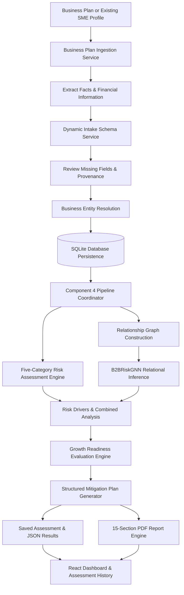

# Component 4: GNN-Based Business Risk Prediction, Mitigation and Scalable Growth Recommendation

> **SME360 AI — Business Lifecycle Decision Support Platform**  
> **Research Group:** J26-IT-362  
> **Institution:** Sri Lanka Institute of Information Technology (SLIIT)  
> **Student Researcher:** Tharindu Chathuranga  
> **Student ID:** IT23325814  
> **Repository Branch:** `Component_4_Tharindu`  

---

## Table of Contents

- [1. Overview](#1-overview)
- [2. Problem Statement](#2-problem-statement)
- [3. Research Contribution and Component Differentiation](#3-research-contribution-and-component-differentiation)
  - [3.1 Objectives](#31-objectives)
  - [3.2 How Component 4 Complements the Other Components](#32-how-component-4-complements-the-other-components)
  - [3.3 Component 4 Decision Subsystems](#33-component-4-decision-subsystems)
- [4. System Architecture and Data Flow](#4-system-architecture-and-data-flow)
  - [4.1 End-to-End Workflow](#41-end-to-end-workflow)
  - [4.2 Workflow Stages](#42-workflow-stages)
  - [4.3 Provenance and Relationship Integrity](#43-provenance-and-relationship-integrity)
- [5. Key Features and Decision Engines](#5-key-features-and-decision-engines)
  - [5.1 Five Risk Categories](#51-five-risk-categories)
  - [5.2 GNN Relational Risk Analysis](#52-gnn-relational-risk-analysis)
  - [5.3 Growth Readiness and Mitigation](#53-growth-readiness-and-mitigation)
- [6. Technology Stack](#6-technology-stack)
- [7. Dataset and Training Pipeline](#7-dataset-and-training-pipeline)
  - [7.1 Synthetic SME Panel Dataset](#71-synthetic-sme-panel-dataset)
  - [7.2 Separate Invoice Collections](#72-separate-invoice-collections)
  - [7.3 Graph Construction and Features](#73-graph-construction-and-features)
  - [7.4 Data Splitting](#74-data-splitting)
  - [7.5 Model Training](#75-model-training)
- [8. Scientific Evaluation and Empirical Results](#8-scientific-evaluation-and-empirical-results)
  - [8.1 Held-Out Test Distribution](#81-held-out-test-distribution)
  - [8.2 Model Comparison](#82-model-comparison)
  - [8.3 Confusion Matrices](#83-confusion-matrices)
  - [8.4 Bootstrap Comparison and Research Interpretation](#84-bootstrap-comparison-and-research-interpretation)
  - [8.5 Evaluation Limitations](#85-evaluation-limitations)
- [9. Installation and Local Setup](#9-installation-and-local-setup)
  - [9.1 Prerequisites](#91-prerequisites)
  - [9.2 Clone the Repository](#92-clone-the-repository)
  - [9.3 Set Up the Python Environment](#93-set-up-the-python-environment)
  - [9.4 Install Frontend Dependencies](#94-install-frontend-dependencies)
  - [9.5 Verify Required Artifacts](#95-verify-required-artifacts)
  - [9.6 Run the Backend](#96-run-the-backend)
  - [9.7 Run the Frontend](#97-run-the-frontend)
- [10. Application Usage Walkthrough](#10-application-usage-walkthrough)
- [11. REST API Reference](#11-rest-api-reference)
- [12. Testing and Verification](#12-testing-and-verification)
- [13. Project Structure](#13-project-structure)
- [14. Limitations and Responsible Use](#14-limitations-and-responsible-use)
- [15. Research Team, License, and Deployment](#15-research-team-license-and-deployment)

---

## 1. Overview

**Component 4** is the risk-assessment, mitigation, and growth-readiness component of the **AI-Driven SME Business Lifecycle Decision Support System**. It is designed to help small and medium-sized enterprises (SMEs) understand business risks, inspect relevant business relationships, and make more informed decisions about proposed growth activities.

The component combines three distinct forms of analysis:
1. **Deterministic Five-Category Risk Assessment:** Objective, bounded evaluation across Credit, Market, Inflation, Liquidity, and Operational Risk.
2. **Graph Neural Network (GNN) Analysis:** Relational and supply-chain topology context from available business-to-business (B2B) trade relationships using a 2-layer Graph Convolutional Network (`B2BRiskGNN`).
3. **Growth-Readiness and Mitigation Logic:** Contextual evaluation of a user-selected growth action (e.g., opening a branch, increasing inventory, hiring staff) producing structured, prioritized operational mitigations.

Users can upload an existing business plan (PDF, DOCX, TXT, or JSON), import an available Component 1 feasibility plan, or work with a previously saved SME business profile. The system automatically identifies missing information, tracks value provenance (extracted vs. user-declared vs. simulated), performs multi-category risk analyses, and compiles a comprehensive, downloadable **15-section PDF mitigation plan**.

> [!IMPORTANT]
> **Research Integrity Note:**  
> The current SME panel dataset, its associated risk labels, and its relationship edges are **synthetic** (`Verified_Flag=0`). The GNN functions as a research prototype for relational risk-context modeling; its predictions must **not** be interpreted as validated real-world default or bankruptcy probabilities.

---

## 2. Problem Statement

Small and Medium Enterprises (SMEs) face interacting financial, operational, market, and supply-chain risks. In developing economies such as Sri Lanka—with particular relevance to the commercially active Western Province (Colombo, Gampaha, Kalutara)—common vulnerabilities include:
- Limited or non-existent formal credit histories.
- Fluctuating imported input costs and macroeconomic inflation shocks.
- High supplier or customer concentration dependencies.
- Severe cash-flow pressure and working capital depletion.
- Operational delivery delays and capacity bottlenecks.
- Premature or over-leveraged business expansion decisions that exhaust liquidity runway.

Business feasibility assessment and ongoing risk management answer fundamentally different questions. A business may possess a plausible initial plan but still face evolving risks as it begins operating or considers expansion. A useful decision-support workflow must inspect both **internal firm indicators** and the **external network of relationships** connecting the business to trade partners, suppliers, and lenders.

Component 4 addresses this need by providing:
- Transparent, bounded risk scores across five distinct operational risk categories.
- Graph-based topological context from available B2B buyer-seller relationships.
- A structured evaluation of a user-selected growth action (`PROCEED`, `MODIFY`, or `DELAY`).
- Empirical risk-driver explanations and prioritized, 13-attribute mitigation roadmaps.
- Persistent assessment records, scenario simulation, and downloadable audit-grade reports.

### Target Users
- **SME Founders & Entrepreneurs:** Evaluating business risk profiles and the feasibility of prospective growth initiatives.
- **Commercial Bank Credit Officers & Micro-Lenders:** Seeking contextual indicators and trade-relationship insights alongside conventional accounting statements.
- **SME Development Agencies & Business Advisors:** Formulating tailored, evidence-grounded risk mitigation roadmaps for small enterprises.

---

## 3. Research Contribution and Component Differentiation

### 3.1 Objectives
Component 4 is engineered to:
1. Ingest business plans across PDF, DOCX, TXT, and JSON formats.
2. Identify missing information and explicitly track value provenance (`EXTRACTED`, `USER_DECLARED`, `SIMULATED`).
3. Calculate bounded risk scores for Credit, Market, Inflation, Liquidity, and Operational Risk.
4. Apply a Graph Neural Network to analyze the topology of available business relationships for relational risk context.
5. Evaluate user-selected growth actions and return an actionable `PROCEED`, `MODIFY`, or `DELAY` recommendation.
6. Map identified risk drivers directly to structured, prioritized operational mitigations.
7. Persist assessment records in a local database and generate an audit-ready, 15-section PDF report.

### 3.2 How Component 4 Complements the Other Components

| Component | Main Responsibility | Primary Question Addressed |
| :--- | :--- | :--- |
| **Component 1** | Business feasibility and strategy recommendation | *"Is this business idea or initial plan feasible?"* |
| **Component 2** | Legal, registration, and regulatory guidance | *"Which legal, registration, and licensing requirements apply?"* |
| **Component 3** | Financial monitoring and anomaly/fraud detection | *"Are there unusual financial transactions or potential ledger anomalies?"* |
| **Component 4 (This Component)** | **Risk assessment, relational risk context, mitigation, and growth readiness** | ***"What risks may affect this business, and is it ready to carry out a selected growth action?"*** |

Component 1 uses a tabular feasibility workflow and can pass a business plan or structured record directly to Component 4. Component 4 focuses on post-initiation risk and growth readiness rather than repeating the initial feasibility assessment.

### 3.3 Component 4 Decision Subsystems
To ensure scientific clarity, the implementation separates four distinct decision subsystems:
1. **Deterministic Five-Category Risk Engine:** Calculates transparent, bounded sub-scores [0.0–1.0] from empirical financial and operational inputs without uncalibrated default probability claims.
2. **`B2BRiskGNN` Relational Classifier:** Analyzes graph topology and business relationship context. It is not an unassisted standalone real-world default predictor.
3. **Risk-Driver and Mitigation Mapping Engine:** Connects observed inputs and threshold conditions to concrete operational mitigations with 13 structured attributes.
4. **Growth-Readiness Evaluator:** Evaluates a selected growth action against capital runway impact and capacity constraints to return `PROCEED`, `MODIFY`, or `DELAY`.

---

## 4. System Architecture and Data Flow

### 4.1 End-to-End Workflow



### 4.2 Workflow Stages
1. **Plan Ingestion:** The user uploads a supported business plan file (`.pdf`, `.docx`, `.txt`, `.json`) or selects an existing Component 1 record.
2. **Extraction and Intake:** The system extracts available facts, flags missing values, detects conflicting numbers, and displays the intake form for user review.
3. **Entity Resolution:** The system checks for matching persistent business records and counterparties using exact registration numbers, IDs, or name/district combinations. **Relationship edges are never fabricated to artificially connect the graph.**
4. **Risk Assessment:** The deterministic engine calculates scores across the five risk categories and attributes specific primary drivers.
5. **Graph Analysis:** The GNN processes the graph topology and 41 node features to produce relational context embeddings and topological risk scores.
6. **Growth Evaluation:** The growth evaluator models post-action liquidity runway and capacity gaps, returning a `PROCEED`, `MODIFY`, or `DELAY` decision.
7. **Mitigation and Reporting:** The engine constructs a 13-attribute prioritized mitigation plan, persists run artifacts, and exports a 15-section downloadable PDF report.

### 4.3 Provenance and Relationship Integrity
The intake workflow records whether every value is:
- `EXTRACTED`: Parsed directly from an uploaded document.
- `USER_DECLARED`: Entered or modified by the user during intake.
- `SIMULATED`: Generated as part of an experimental scenario.

The relationship graph visualizer visually distinguishes verified trade relationships from user-declared or simulated connections. This distinction ensures users and researchers do not mistake hypothetical scenario connections for confirmed commercial transactions.

---

## 5. Key Features and Decision Engines

| Feature | Description | Main Implementation File |
| :--- | :--- | :--- |
| **Multi-format Plan Ingestion** | Ingests PDF, DOCX, TXT, and JSON business plans with safe handling and a 15MB upload limit. | [`src/component4/business_plan_ingestion.py`](file:///C:/Users/Tharindu/Desktop/AI-Driven-Business-Lifecycle-Decision-Support-System/src/component4/business_plan_ingestion.py) |
| **Dynamic Intake Schema** | Flags missing information, detects numerical contradictions, and tracks per-field provenance. | [`src/component4/intake_schema.py`](file:///C:/Users/Tharindu/Desktop/AI-Driven-Business-Lifecycle-Decision-Support-System/src/component4/intake_schema.py) |
| **Persistent Entity Resolution** | Matches businesses by confirmed ID, registration number, or name/district without edge fabrication. | [`src/component4/entity_resolution.py`](file:///C:/Users/Tharindu/Desktop/AI-Driven-Business-Lifecycle-Decision-Support-System/src/component4/entity_resolution.py) |
| **Five-Category Risk Assessment** | Scores Credit, Market, Inflation, Liquidity, and Operational Risk on bounded [0.0, 1.0] scales. | [`src/component4/risk_assessment.py`](file:///C:/Users/Tharindu/Desktop/AI-Driven-Business-Lifecycle-Decision-Support-System/src/component4/risk_assessment.py) |
| **GNN Relational Analysis** | Two-layer Graph Convolutional Network (`B2BRiskGNN`) capturing supply-chain topological contagion. | [`src/component4/gnn_model.py`](file:///C:/Users/Tharindu/Desktop/AI-Driven-Business-Lifecycle-Decision-Support-System/src/component4/gnn_model.py) |
| **Graph Construction & Features** | Constructs NetworkX and PyG graph structures and derives 41 continuous node features. | [`src/component4/graph_construction.py`](file:///C:/Users/Tharindu/Desktop/AI-Driven-Business-Lifecycle-Decision-Support-System/src/component4/graph_construction.py) |
| **Growth-Readiness Evaluation** | Evaluates proposed growth actions and returns `PROCEED`, `MODIFY`, or `DELAY`. | [`src/component4/growth_readiness.py`](file:///C:/Users/Tharindu/Desktop/AI-Driven-Business-Lifecycle-Decision-Support-System/src/component4/growth_readiness.py) |
| **Structured Mitigation Roadmap** | Maps risk drivers to concrete operational action items with 13 structured attributes. | [`src/component4/risk_assessment.py`](file:///C:/Users/Tharindu/Desktop/AI-Driven-Business-Lifecycle-Decision-Support-System/src/component4/risk_assessment.py) |
| **15-Section PDF Export** | Generates an audit-ready, 15-section PDF report with two-pass page numbering and Unicode Sinhala font support. | [`src/component4/mitigation_pdf_generator.py`](file:///C:/Users/Tharindu/Desktop/AI-Driven-Business-Lifecycle-Decision-Support-System/src/component4/mitigation_pdf_generator.py) |
| **Interactive Scenario Analysis** | Allows users to simulate how changes in revenue, costs, debt, or trade counterparties affect risk scores. | [`frontend/src/components/Component4Scenarios.jsx`](file:///C:/Users/Tharindu/Desktop/AI-Driven-Business-Lifecycle-Decision-Support-System/frontend/src/components/Component4Scenarios.jsx) |
| **Interactive Graph Visualizer** | Renders business trade networks with distinct visual styling for verified vs. declared vs. simulated links. | [`frontend/src/components/Component4RiskSuite.jsx`](file:///C:/Users/Tharindu/Desktop/AI-Driven-Business-Lifecycle-Decision-Support-System/frontend/src/components/Component4RiskSuite.jsx) |
| **Assessment History Registry** | Persists and displays historical assessment runs, trends, and previous PDF downloads. | [`frontend/src/components/Component4Reports.jsx`](file:///C:/Users/Tharindu/Desktop/AI-Driven-Business-Lifecycle-Decision-Support-System/frontend/src/components/Component4Reports.jsx) |
| **Component 1 Plan Handoff** | Seamlessly imports Component 1 feasibility records into Component 4 intake. | [`backend/routes/component4_risk.py`](file:///C:/Users/Tharindu/Desktop/AI-Driven-Business-Lifecycle-Decision-Support-System/backend/routes/component4_risk.py) |
| **PII Data Anonymization** | Scrubs taxpayer identifiers, telephone numbers, emails, and personal names from logs and text. | [`src/component4/anonymization.py`](file:///C:/Users/Tharindu/Desktop/AI-Driven-Business-Lifecycle-Decision-Support-System/src/component4/anonymization.py) |

### 5.1 Five Risk Categories
- **Credit Risk:** Debt burden ratio, debt-service coverage ratio (DSCR), and overdue repayment history.
- **Market Risk:** Customer concentration (Herfindahl-Hirschman Index / CR1), sales growth trends, and competitive density.
- **Inflation Risk:** Imported input reliance, fuel/transport expense share, and cost increase pass-through flexibility.
- **Liquidity Risk:** Post-action cash runway (months), monthly cash burn rate, and working capital buffer.
- **Operational Risk:** Supplier concentration (HHI / CR1), supplier delivery delay days, and staff capacity gap.

### 5.2 GNN Relational Risk Analysis
The `B2BRiskGNN` model is implemented as a 2-layer Graph Convolutional Network using PyTorch Geometric:
- **Input Node Dimension:** 41 standardized features.
- **Hidden Layers:** 2 layers of `GCNConv` (64 channels) with Batch Normalization (`BatchNorm1d`), ReLU activations, and Dropout (0.2).
- **Residual Connection:** Skip addition ($h = h_1 + h_2$) between layers 1 and 2.
- **Classification Head:** Multi-layer perceptron (Linear 64 $\to$ 32 $\to$ 3) outputting class logits (`Low`, `Medium`, `High`).

### 5.3 Growth Readiness and Mitigation
The growth evaluator supports decisions regarding opening branches, expanding inventory, hiring staff, or launching products. It yields:
- `PROCEED`: Low risk, healthy post-action runway (>3 months), manageable debt burden, and balanced capacity.
- `MODIFY`: Moderate risk or manageable bottleneck (e.g., phased capital deployment, supplier diversification, hiring).
- `DELAY`: Critical liquidity exhaustion (<1 month runway), excessive debt service (>35% of revenue), or severe capacity deficit.

Mitigation items provide 13 structured attributes: `action_id`, `category`, `priority`, `mitigation_title`, `description`, `target_risk_driver`, `current_observed_value`, `recommended_benchmark`, `timeline`, `responsible_owner`, `estimated_cost_level`, `implementation_difficulty`, and `measurable_kpi`.

---

## 6. Technology Stack

### Frontend
| Technology | Audited Version | Role |
| :--- | :--- | :--- |
| **React** | 18.2.0 | Component-based user interface |
| **Vite** | 5.1.6 | Fast development server and build bundler |
| **React Router DOM** | 6.22.3 | Client-side routing and navigation |
| **Recharts** | 2.12.2 | Data visualization and responsive charts |
| **Lucide React** | 0.344.0 | UI icons |
| **Axios** | 1.6.8 | REST API HTTP client |
| **Tailwind CSS** | 3.4.1 | Utility styling alongside core design system CSS |

### Backend and API
| Technology | Audited Version | Role |
| :--- | :--- | :--- |
| **Python** | 3.13.7 | Runtime environment |
| **FastAPI** | 0.115.11 | High-performance asynchronous REST API |
| **Uvicorn** | 0.34.0 | Production ASGI web server |
| **Pydantic** | 2.14.0 | Schema validation and settings management |
| **SQLAlchemy** | 2.0.46 | Object-Relational Mapping (ORM) |
| **SQLite** | 3.x | Local relational database (`data/component_1.db`) |

### Machine Learning, Graphs, and Data
| Technology | Audited Version | Role |
| :--- | :--- | :--- |
| **PyTorch** | 2.14.1+cpu | Neural network tensor framework |
| **PyTorch Geometric (PyG)** | 2.4.0 | Graph neural network layers (`GCNConv`) |
| **scikit-learn** | 1.9.1 | Preprocessing, Random Forest baseline, and metrics |
| **NetworkX** | 3.7 | Graph topology modeling and graph construction |
| **Joblib** | 1.6.0 | Preprocessor and model serialization |
| **NumPy** | 2.3.2 | Matrix operations and numerical computing |
| **Pandas** | 2.3.2 | Tabular data processing and feature engineering |
| **SciPy** | 1.18.1 | Statistical computations and distance metrics |

### Document Processing and Testing
| Technology | Role |
| :--- | :--- |
| **pypdf** (5.4.0) | PDF text extraction and parsing |
| **python-docx** (1.2.0) | Word document (.docx) business plan ingestion |
| **ReportLab** (4.4.10) | Audit-grade, two-pass 15-section PDF generation |
| **OpenPyXL** (3.1.5) | Excel document parsing |
| **pytest** (9.1.1) | Automated unit, regression, and integration testing |
| **Starlette TestClient / HTTPX** | REST API testing support |
| **ESLint / Pyright** | Code quality, linting, and static type checking |

---

## 7. Dataset and Training Pipeline

### 7.1 Synthetic SME Panel Dataset
The primary dataset is located at `data/Component4_Dataset/Component4_Datasets/`:

| Dataset File | Rows | Columns | Contents |
| :--- | :---: | :---: | :--- |
| `Business_Profile.csv` | 1,000 | 22 | 1,000 SME profiles (firmographics, capital, location) |
| `Business_Relationships.csv` | 3,487 | 15 | 3,487 simulated B2B buyer-supplier trade edges |
| `Credit_Risk_Data.csv` | 24,000 | 11 | Monthly debt, loan repayment delay, and DSCR metrics |
| `Market_Risk_Data.csv` | 24,000 | 9 | Monthly customer concentration (HHI) and sales trends |
| `Inflation_Risk_Data.csv` | 24,000 | 8 | Monthly import reliance and cost pass-through metrics |
| `Liquidity_Risk_Data.csv` | 24,000 | 9 | Monthly cash runway, burn rate, and working capital |
| `Operational_Risk_Data.csv` | 24,000 | 9 | Monthly supplier concentration (HHI) and delivery delays |
| `Monthly_Financials.csv` | 24,000 | 10 | Monthly revenue, COGS, and operating expense records |
| `Risk_Assessment.csv` | 24,000 | 15 | Rule-derived composite risk labels across 24 months |
| `Scenario_Analysis.csv` | 4,000 | 12 | Growth-action simulation records (4 scenarios per SME) |
| `Economic_Indicators.csv` | 72 | 8 | Macro-economic trend placeholders |
| `Data_Dictionary.csv` | 119 | 7 | Comprehensive definitions for all variables |
| `README.txt` | — | — | Explicit synthetic dataset provenance disclosure |

> [!WARNING]
> **Critical Provenance Disclosure:**  
> All records, monthly features, risk labels, and relationship edges in this SME panel are **synthetic**, generated with `Verified_Flag=0`. This dataset is suitable for pipeline, schema, and UI validation; it is not a real-world bankruptcy panel and cannot validate real-world risk prediction claims.

### 7.2 Separate Invoice Collections
The repository also includes real-world invoice collections under `data/Dataset/`:
- **Dataset 07 (`data/Dataset/07`):** 70 PDF files (69 unique, 1 duplicate) documenting software development billing between an Australian corporate parent and its Sri Lankan subsidiary. Dual currencies (`LKR` and `AUD`). **Topology: 2-node bilateral dyad.**
- **Dataset 06 (`data/Dataset/06`):** 171 PDF files (159 unique, 12 binary duplicates) of agricultural export declarations (CUSDEC) and commercial invoices. 53 contain digital text; 118 are scanned raster images. Scanned images are assigned `UNVERIFIED_SCANNED` (`confidence_score = 0.0`) with **zero invented numbers**. **Topology: 11-node radial star graph.**
- **Integrity Rule:** Neither invoice dataset contains ground-truth risk labels, nor do they map to the 1,200 survey records in `data/raw/Component_One_Core_Feasibility.csv`. They were therefore not artificially merged into the SME risk panel.

### 7.3 Graph Construction and Features
- **Nodes:** Each node represents a distinct business entity (`Business_ID`).
- **Node Features:** 41 continuous, standardized features computed from historical Months 18–23 performance (excluding Month 24 target information to eliminate lookahead leakage).
- **Edges:** Directed B2B relationships from `Business_Relationships.csv` representing buyer, supplier, or lender relationships.
- **Edge Weights:** Normalized relationship strength: $w_{ij} = \frac{\text{Relationship\_Strength}}{5.0} \in [0.2, 1.0]$.
- **Self-Loops:** Added ($w_{ii} = 1.0$) to maintain node representation for enterprises without trade partners.

### 7.4 Data Splitting
Splitting is conducted strictly at the `Business_ID` level using random seed `42`:

| Partition | Number of Businesses | Proportion | Notes |
| :--- | :---: | :---: | :--- |
| **Training** | 700 | 70.0% | $G_{\text{train}}$: 1,721 intra-training edges + self-loops |
| **Validation** | 150 | 15.0% | Used strictly for hyperparameter and loss tuning |
| **Held-Out Test** | 150 | 15.0% | Sequestered until final model evaluation |

An inductive subgraph isolation strategy guarantees that validation and test nodes cannot pass messages into training nodes during graph convolutions.

### 7.5 Model Training
To train the GNN and baseline models using the audited configuration:

```powershell
.\.venv\Scripts\python.exe scripts/train_component4_gnn.py --epochs 60 --lr 0.008 --seed 42
```

- **Architecture:** 2-layer GCNConv + BatchNorm + Skip Addition + MLP Head
- **Optimizer:** Adam ($\text{lr} = 0.008$)
- **Loss Function:** Focal Loss ($\gamma = 1.5$) with class weighting
- **Saved Checkpoint:** `models/component4/gnn_risk_model_inductive_v2.1.pt`
- **Preprocessor Artifact:** `models/component4/gnn_preprocessor.joblib`

---

## 8. Scientific Evaluation and Empirical Results

### 8.1 Held-Out Test Distribution
The sequestered test split ($N = 150$) contains the following ground-truth distribution:

| Ground-Truth Class | Count | Percentage |
| :--- | :---: | :---: |
| **Low Risk** | 121 | 80.67% |
| **Medium Risk** | 29 | 19.33% |
| **High Risk** | 0 | 0.00% |

> [!CAUTION]
> **Unevaluable High-Risk Class:**  
> The full 1,000-business dataset contains only 2 High-risk businesses (0.2%). Because the held-out test split contains **0 High-risk examples**, held-out High-risk precision, recall, and detection capability **cannot be measured**. All models receive $F_1(\text{High}) = 0.0$.

### 8.2 Model Comparison (Held-Out Test Set, $N = 150$)
All metrics are recomputed directly from saved checkpoints and ground-truth arrays:

| Model Architecture | Evaluation Topology | Test Acc | BalAcc (3c) | BalAcc (2c) | Macro-F1 (3c) | Macro-F1 (2c) | Medium Recall | Predicted Counts [L/M/H] |
| :--- | :--- | :---: | :---: | :---: | :---: | :---: | :---: | :---: |
| **Random Forest Baseline** | Tabular Non-Graph | 55.33% | 51.34% | 51.34% | 0.3186 | 0.4779 | **44.8% (13/29)** | 86 / 64 / 0 |
| **GNN v2.1 Baseline** | Strict Isolated Subgraph | 58.00% | 50.37% | 50.37% | 0.3284 | 0.4926 | 37.9% (11/29) | 93 / 51 / 6 |
| **GNN v2.1 Baseline** | Extended Network | 74.67% | 50.21% | 50.21% | 0.3326 | 0.4989 | 10.3% (3/29) | 134 / 13 / 3 |
| **Selected Candidate (Focal $\gamma=1.5$)** | Strict Isolated Subgraph | 76.00% | 51.04% | 51.04% | 0.3344 | 0.5017 | 10.3% (3/29) | 137 / 13 / 0 |
| **Selected Candidate (Focal $\gamma=1.5$)** | Extended Network | 79.33% | 49.17% | 49.17% | 0.2949 | 0.4424 | 0.0% (0/29) | 148 / 2 / 0 |
| **Sensitivity Candidate (Focal $\gamma=3.0$)** | Strict Isolated Subgraph | 64.00% | 47.53% | 47.53% | 0.3170 | 0.4755 | 20.7% (6/29) | 113 / 37 / 0 |
| **Sensitivity Candidate (Focal $\gamma=3.0$)** | Extended Network | 74.67% | 47.59% | 47.59% | 0.3013 | 0.4519 | 3.5% (1/29) | 139 / 11 / 0 |

*Interpretation:* The highest raw accuracy (79.33%) occurs when the model predicts nearly all businesses as Low risk, detecting 0 of the 29 Medium-risk businesses. High raw accuracy therefore reflects majority-class alignment rather than balanced risk discrimination. The non-graph Random Forest baseline achieved the highest Medium-risk recall (44.8%).

### 8.3 Confusion Matrices
Rows represent True Labels $[\text{Low}, \text{Medium}, \text{High}]$; Columns represent Predicted Labels $[\text{Low}, \text{Medium}, \text{High}]$.

**1. Random Forest Baseline:**
```text
[[70, 51,  0],
 [16, 13,  0],
 [ 0,  0,  0]]
```

**2. GNN v2.1 Baseline (Isolated Subgraph):**
```text
[[76, 40,  5],
 [17, 11,  1],
 [ 0,  0,  0]]
```

**3. Selected Candidate: Focal Loss $\gamma=1.5$ (Isolated Subgraph):**
```text
[[111, 10,  0],
 [ 26,  3,  0],
 [  0,  0,  0]]
```

### 8.4 Bootstrap Comparison and Research Interpretation
Paired bootstrap hypothesis testing ($B = 1,000$ resamples at the business level, seed `42`) shows:
- **Accuracy:** The Selected Candidate achieves statistically significant superior raw accuracy over Random Forest ($+20.70\%$, $95\%$ CI $[+10.65\%, +31.33\%]$, $p < 0.05$).
- **Balanced Accuracy:** The difference between GNN and Random Forest is not statistically significant ($\Delta = -0.55\%$, $95\%$ CI $[-12.87\%, +11.87\%]$, $p \ge 0.05$).
- **Macro-F1 (3-class):** The difference between GNN and Random Forest is not statistically significant ($\Delta = +0.0148$, $95\%$ CI $[-0.0628, +0.1010]$, $p \ge 0.05$).

**Empirical Conclusion:** There is no evidence of statistically significant GNN superiority over Random Forest on balanced classification. The GNN is incorporated as a relational topological embedding feature in a hybrid decision-support architecture, rather than as an unassisted replacement for financial tabular models.

### 8.5 Evaluation Limitations
1. **Synthetic Data:** The SME panel, labels, and edges are synthetic; results do not establish real-world SME risk prediction.
2. **Rule-Derived Labels:** Target labels are rule-derived rather than verified external loan defaults or bankruptcies.
3. **Absence of High-Risk Test Cases:** High-risk detection cannot be measured on the held-out test split.
4. **Imbalance Sensitivity:** High raw accuracy is driven by the majority Low-risk class.
5. **Simulated Edges:** Graph edges are simulated and must remain clearly distinguished from verified trade transactions.
6. **No Autonomous Underwriting:** The system produces advisory decision support, not binding loan approvals or commercial guarantees.

---

## 9. Installation and Local Setup

### 9.1 Prerequisites
- **Operating System:** Windows 10/11 x64 (PowerShell supported), Linux, or macOS.
- **Python:** Python 3.10 to 3.13 (Audited on Python 3.13.7).
- **Node.js:** Node.js v18+ (Audited on Node.js v22.14.0, npm 11.12.1).
- **Git:** Git 2.30+.

### 9.2 Clone the Repository
```powershell
git clone https://github.com/kumodyathamadi/AI-Driven-Business-Lifecycle-Decision-Support-System.git
cd AI-Driven-Business-Lifecycle-Decision-Support-System
git checkout Component_4_Tharindu
```

### 9.3 Set Up the Python Environment
```powershell
python -m venv .venv
.\.venv\Scripts\Activate.ps1
python -m pip install --upgrade pip
pip install -r requirements.txt
```

### 9.4 Install Frontend Dependencies
```powershell
cd frontend
npm install
cd ..
```

### 9.5 Verify Required Artifacts
```powershell
.\.venv\Scripts\python.exe -c "import os; assert os.path.exists('models/component4/gnn_risk_model_inductive_v2.1.pt'); assert os.path.exists('data/component_1.db'); print('Artifacts Verified Successfully!')"
```

### 9.6 Run the Backend
```powershell
.\.venv\Scripts\Activate.ps1
python -m uvicorn backend.main:app --host 127.0.0.1 --port 8000 --reload
```
- API Base URL: `http://127.0.0.1:8000`
- API Documentation (Swagger UI): `http://127.0.0.1:8000/docs`
- Health Check: `http://127.0.0.1:8000/api/health`

### 9.7 Run the Frontend
Open a second terminal:
```powershell
cd frontend
npm run dev
```
- Frontend UI URL: `http://localhost:5173` (or `http://localhost:3000`)

---

## 10. Application Usage Walkthrough

### Step 1 — Upload or Select a Business Plan
Navigate to **"New Risk Assessment"** in the sidebar. Select an upload option:
- Upload a business plan document (`.pdf`, `.docx`, `.txt`, `.json`).
- Load an existing Component 1 feasibility plan.
- Select a previously registered SME profile from the database.

### Step 2 — Review Extracted Facts and Complete Missing Fields
The parser extracts financial and operational metrics. Missing values (e.g., debt repayment schedule, supplier concentration) are highlighted. Review and confirm values with explicit provenance tags (`EXTRACTED` vs. `USER_DECLARED`).

### Step 3 — Confirm Business Identity and Provenance
Confirm the business identity against persistent records. Review trade counterparties, observing clear provenance distinctions (`VERIFIED_OBSERVED`, `USER_DECLARED`, or `SIMULATED_SCENARIO`).

### Step 4 — Review Multi-Category Risk Results
Inspect the Composite Risk Score and individual category breakdown cards: Credit, Market, Inflation, Liquidity, and Operational Risk. Review primary risk drivers and GNN supply-chain relational context.

### Step 5 — Evaluate Growth Readiness
Select a proposed growth action (e.g., "Open New Branch", "Increase Inventory"). Review the resulting `PROCEED`, `MODIFY`, or `DELAY` recommendation based on capital runway impact and capacity constraints.

### Step 6 — Review Mitigations and Export Report
Review the 13-attribute prioritized mitigation roadmap. Click **"Download 15-Section Mitigation Plan (PDF)"** to export an audit-grade report.

---

## 11. REST API Reference

All endpoints below are implemented in `backend/routes/component4_risk.py` with prefix `/api/component4`:

| Method | Endpoint | Purpose |
| :--- | :--- | :--- |
| `POST` | `/api/component4/plan/upload` | Upload and parse business plan; return extracted facts, missing fields, and candidate matches. |
| `GET` | `/api/component4/component1-plans` | List available Component 1 feasibility records. |
| `POST` | `/api/component4/plan/load-component1/{record_id}` | Load a Component 1 plan directly into Component 4 intake. |
| `POST` | `/api/component4/intake/submit-and-run` | Submit reviewed intake facts and execute the complete pipeline. |
| `POST` | `/api/component4/analysis/run` | Execute analysis using an already uploaded plan file path. |
| `POST` | `/api/component4/assess` | Evaluate a structured JSON payload directly. |
| `GET` | `/api/component4/business/{business_id}/history` | Retrieve assessment history for a specific business. |
| `GET` | `/api/component4/assessments/recent` | Retrieve recent assessment runs across all businesses. |
| `GET` | `/api/component4/businesses` | List all registered persistent SME profiles. |
| `GET` | `/api/component4/analysis/{analysis_id}` | Retrieve complete analysis JSON by run ID. |
| `GET` | `/api/component4/analysis/{analysis_id}/report` | Retrieve Markdown assessment report text. |
| `GET` | `/api/component4/analysis/{analysis_id}/mitigation-plan.pdf` | Generate and download the 15-section PDF report. |
| `GET` | `/api/component4/analysis/{analysis_id}/pdf` | Alias for PDF mitigation plan download. |
| `GET` | `/api/component4/graph/{business_id}` | Retrieve graph nodes, edges, and relationship provenance data. |
| `GET` | `/api/component4/candidates` | Search candidate business entities for disambiguation. |
| `GET` | `/api/component4/model-status` | Check GNN checkpoint, preprocessor, and baseline artifact status. |

---

## 12. Testing and Verification

The test suite covers unit logic, mathematical boundaries, API routing, pipeline integration, and PDF generation. All 132 tests pass with zero failures:

| Test File | Tests | Execution Command | Result |
| :--- | :---: | :--- | :---: |
| `tests/test_component4_integrity.py` | 21 | `pytest tests/test_component4_integrity.py` | **21 PASSED** |
| `tests/test_component4.py` | 30 | `pytest tests/test_component4.py` | **30 PASSED** |
| `tests/test_component4_pdf_and_categories.py` | 15 | `pytest tests/test_component4_pdf_and_categories.py` | **15 PASSED** |
| `tests/test_component4_pipeline.py` | 16 | `pytest tests/test_component4_pipeline.py` | **16 PASSED** |
| `tests/test_risk_input_driven_calculations.py` | 37 | `pytest tests/test_risk_input_driven_calculations.py` | **37 PASSED** |
| `tests/test_component1_risk_integration.py` | 12 | `pytest tests/test_component1_risk_integration.py` | **12 PASSED** |
| `tests/test_e2e_dry_run.py` | 1 | `pytest tests/test_e2e_dry_run.py` | **1 PASSED** |
| **Total Test Suite** | **132** | `pytest tests/` | **132 PASSED** (100%) |

Execute the full suite from the repository root:
```powershell
.\.venv\Scripts\python.exe -m pytest tests/
```

---

## 13. Project Structure

```text
AI-Driven-Business-Lifecycle-Decision-Support-System/
├── backend/
│   ├── database.py                              # SQLite session & Base declarative model
│   ├── main.py                                  # FastAPI application setup & router registration
│   ├── models.py                                # Component4BusinessProfile, Relationship, AssessmentRun
│   └── routes/
│       └── component4_risk.py                   # 16 REST endpoints for Component 4
├── data/
│   ├── Component4_Dataset/
│   │   └── Component4_Datasets/                 # 1,000 SME synthetic panel (24 months)
│   ├── Dataset/                                 # Real-world corporate invoices (06 & 07)
│   ├── component_1.db                           # SQLite database file
│   └── processed/
│       └── component4/                          # Processed NetworkX & PyG graph artifacts
├── frontend/
│   ├── package.json                             # React 18, Vite 5, Lucide-React, Recharts
│   └── src/
│       ├── App.jsx                              # Workspace navigation orchestrator
│       ├── components/
│       │   ├── Component4RiskSuite.jsx          # 5-step risk assessment wizard & dashboard
│       │   ├── Component4Overview.jsx           # Component 4 home dashboard
│       │   ├── Component4Reports.jsx            # Reports registry & markdown viewer
│       │   ├── Component4Scenarios.jsx          # Dynamic scenario analysis workspace
│       │   ├── MyAssessments.jsx                # Persistent SME profile registry
│       │   ├── WorkspaceContextBar.jsx          # Active business context & provenance bar
│       │   ├── Sidebar.jsx                      # Navigation sidebar
│       │   └── Navbar.jsx                       # Top navigation bar
│       └── services/
│           └── api.js                           # Axios REST API client
├── models/
│   └── component4/
│       ├── gnn_risk_model_inductive_v2.1.pt     # Production B2BRiskGNN checkpoint
│       ├── gnn_risk_model.pt                    # Standard PyG model checkpoint
│       ├── gnn_model_metadata.json              # Hyperparameters & audit metadata
│       ├── gnn_preprocessor.joblib              # 41-feature standardizer
│       ├── feasibility_model.joblib             # Random Forest baseline checkpoint
│       └── experiments/                         # Phase 3 candidate checkpoints
├── reports/
│   └── component4/
│       ├── gnn_evaluation_report.json           # Comprehensive evaluation metrics
│       ├── phase4_final_comparison_corrected.md # Bootstrap CI & hypothesis testing audit
│       ├── phase4_final_comparison_corrected.json # Recomputed confusion matrices
│       ├── stage3_graph_construction_report.md  # Invoice extraction & topology report
│       ├── stage6_risk_assessment.md            # 5-dimension engine documentation
│       └── analysis_runs/                       # 304 execution run output folders
├── scripts/
│   ├── train_component4_gnn.py                  # Standalone GNN & baseline training script
│   └── update_component4_metadata.py            # Model metadata and schema synchronizer
├── src/
│   └── component4/
│       ├── anonymization.py                     # PII scrubbing & token masking
│       ├── business_plan_ingestion.py           # Ingestion for PDF, DOCX, TXT, JSON plans
│       ├── data_inspection.py                   # Data inspection and integrity checks
│       ├── dataset_validation.py                # Schema validation & boundary checks
│       ├── entity_resolution.py                 # Persistent entity matching (zero fabrication)
│       ├── feasibility_baseline.py              # Tabular Random Forest baseline
│       ├── gnn_model.py                         # B2BRiskGNN architecture & inference engine
│       ├── graph_construction.py                # NetworkX and PyG graph construction
│       ├── growth_readiness.py                  # Growth action evaluator (PROCEED, MODIFY, DELAY)
│       ├── intake_schema.py                     # Dynamic intake schema & provenance service
│       ├── invoice_extraction.py                # PDF & regex invoice parser
│       ├── mitigation_pdf_generator.py          # 15-section PDF generator with Sinhala font
│       ├── pipeline.py                          # End-to-end coordinator (Intake -> GNN -> PDF)
│       ├── preprocessing.py                     # Tabular pipeline & leakage-free splits
│       ├── risk_assessment.py                   # Deterministic 5-category risk engine
│       └── risk_features.py                     # Financial ratios & temporal feature engineering
└── tests/
    ├── test_component4.py                       # Core tests across Stages 1–7
    ├── test_component4_integrity.py             # Architectural integrity & provenance tests
    ├── test_component4_pdf_and_categories.py    # Tests for 5 categories & 15-section PDF
    ├── test_component4_pipeline.py              # End-to-end pipeline execution tests
    ├── test_component1_risk_integration.py      # Cross-component handoff tests
    ├── test_risk_input_driven_calculations.py   # Mathematical boundary & formula tests
    └── test_e2e_dry_run.py                      # Dry run test for full application execution
```

---

## 14. Limitations and Responsible Use

1. **Synthetic Data Foundation:** The primary 1,000-business panel, monthly features, risk labels, and relationship edges are synthetic. They serve to prototype the pipeline and user interface, not to substantiate real-world credit claims.
2. **No High-Risk Examples in Test Split:** The held-out test cohort contains zero High-risk examples. Consequently, High-risk bankruptcy detection cannot be evaluated from this split.
3. **Class Imbalance:** Raw accuracy is heavily influenced by the majority Low-risk class ($80.67\%$). Balanced Accuracy and class-level recall must always be reviewed alongside accuracy.
4. **Medium-Risk Detection Trade-off:** High-accuracy GNN configurations exhibit lower Medium-risk recall; the audit does not find statistically significant GNN superiority over the tabular Random Forest baseline on balanced metrics.
5. **Relationship Evidence Distinctions:** Simulated and user-declared edges must remain clearly distinguished from verified empirical trade transactions.
6. **Input Quality Sensitivity:** Incomplete, estimated, or outdated inputs will materially alter risk scores and growth recommendations.
7. **No Autonomous Underwriting:** The system produces advisory decision support, not binding loan approvals or commercial guarantees.
8. **Privacy and Data Minimization:** Real business documents should be scrubbed of confidential personal data before processing. Real identifiers, credentials, and financial statements must never be committed to version control.
9. **Local Execution Context:** The audited system is configured for local development. Further work is required to establish production deployment, monitoring, and compliance governance.

---

## 15. Research Team, License, and Deployment

### Research Information
- **Parent Project:** AI-Driven SME Business Lifecycle Decision Support System
- **Research Component:** Component 4 — GNN-Based Business Risk Prediction, Mitigation and Scalable Growth Recommendation
- **Student Researcher:** Tharindu Chathuranga
- **Student ID:** `IT23325814`
- **Research Group:** `J26-IT-362`
- **Institution:** Sri Lanka Institute of Information Technology (SLIIT)

### Deployment Status
The project is configured for local execution using FastAPI and Vite React. No public cloud deployment, Docker container, or hosted endpoint is configured.

### License
This software and its documentation are developed for **academic and research purposes**. No commercial or open-source warranty is implied.

### Acknowledgment
This research component forms part of the final-year research initiative *AI-Driven SME Business Lifecycle Decision Support System* at the Sri Lanka Institute of Information Technology (SLIIT). Subsequent development should prioritize external validation with lawful real-world SME panels, expanded risk class coverage, and domain-expert evaluation before deployment in consequential financial decisions.

---
*Research Disclaimer: Results presented in this README are based on the verified Component 4 repository audit report. Reported metrics reflect the synthetic dataset and evaluation methodology described herein and do not constitute evidence of validated real-world SME default prediction.*
